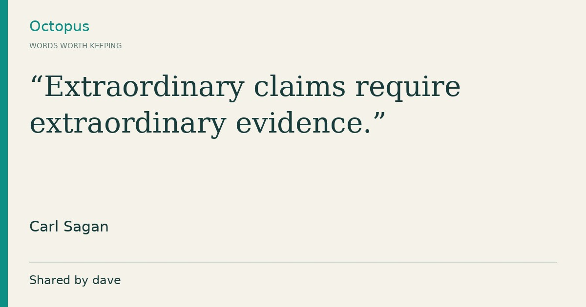
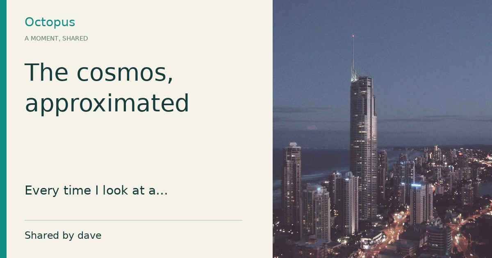
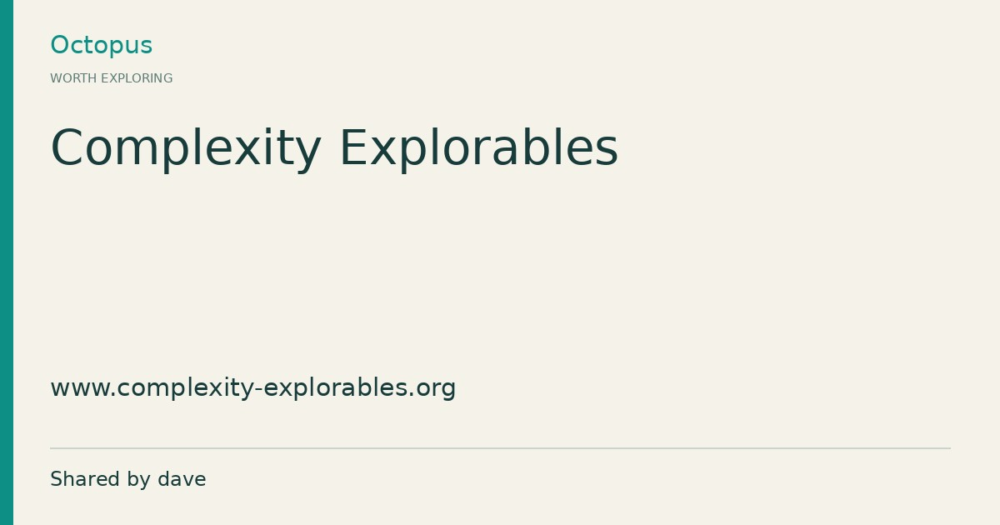

# Public post previews

The existing promotion plan is unchanged. Share uses `/p/<id>.html` once the
published preview appears in `share-posts.json`. Old `post.html?id=...` links
continue working. A browser opening a share page is sent to that same live
post view; a crawler gets Open Graph metadata directly in the HTML response.
Without JavaScript the share page has a readable summary and a full-post link.

## Architecture decision

| Approach | Operation and cost | Tradeoff |
| --- | --- | --- |
| Static HTML + JPEG in Pages (selected) | Existing hosting and GitHub Actions allowance; no new service, credentials or domain | Snapshot freshness follows successful deployments |
| Appwrite HTTP Function for HTML + image | Immediate metadata; needs function deployment, public domain/URL, runtime dependencies and request/compute budget | Additional service lifecycle, caching and abuse controls |

Deploy runs on main pushes, manually, and every 15 minutes. GitHub schedules
can be delayed; this is not a 15-minute freshness guarantee. Before a preview
exists, Share retains the original working URL (without an individual preview).
An already open tab refreshes readiness when reloaded. If immediate previews
for brand-new posts become essential, use an Appwrite HTTP function instead.
No advertising, paid resources or domain purchase are involved.

## Generation and safety

The generator reads configuration from `js/config.js`, paginates anonymously,
and exports only explicitly published posts. No API key or session is used.
It downloads only Appwrite storage images, never arbitrary link destinations.
Quotes use serif typography and source attribution; photos use an EXIF-aware
centre crop and title; links show title and hostname. Other posts and missing
images use typography. DejaVu fonts support Cyrillic. Text is measured, wrapped
(including unbroken URLs), resized and ellipsized within fixed safe areas.
HTML attributes and text are escaped. Images have content-hashed URLs.

Every build recreates `p/`, removing deleted and unpublished snapshots. A failed
public list request fails deployment rather than publishing a partial feed.
Unavailable images fall back to text. Previously deployed snapshots persist
until the next successful deployment, and social networks may retain their own
cached previews after edits/deletion. This is a public-content feature, not a
mechanism for making previously public content private.

## Reproduce

```sh
pip install -r scripts/preview-requirements.txt
# Install fonts-dejavu-core and xsltproc through your OS package manager.
python -m unittest discover -s tests -p 'test_*.py'
bash scripts/build.sh
python scripts/post_previews.py --site-url https://corepunch.github.io/octopus/
```

Tests cover metadata without running JS, absolute subdirectory URLs, JPEG
format/dimensions, visible rendering, Cyrillic/long-token wrapping, escaping,
path traversal and removal of unpublished/deleted pages. PR CI also builds the
existing site. After deployment, inspect `/p/<id>.html` with `curl` and use the
social network's debugger to request a fresh scrape; existing query-string
URLs cannot gain per-post server metadata on GitHub Pages.

## Actual public examples

Generated from anonymous Appwrite responses on 2026-10-28. Source documents
are in `preview-examples/source-posts.json`; no content was invented.




